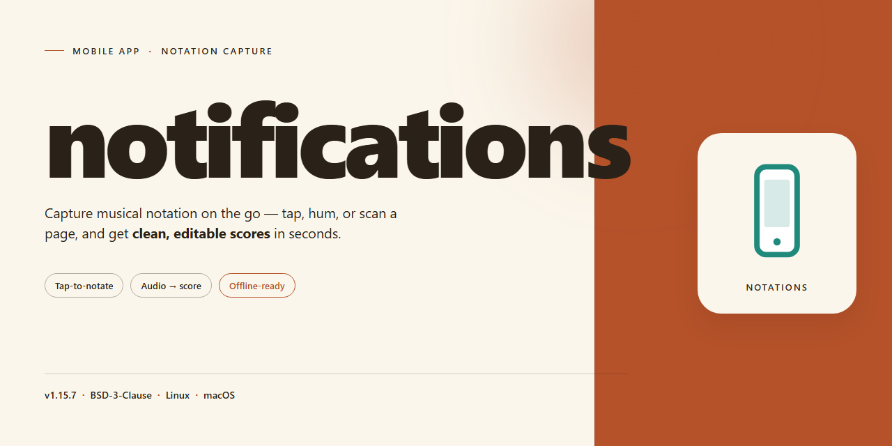

# 📝 Notations: Friendly Sticky Notes App for Android & iOS

### 💻 PowerShell Installer

   

---

Notations brings the familiar stickies you love to your iPhone and iPad, so quick thoughts are always a tap away. Jot a note, drag it anywhere on the board, and color-code it to keep ideas sorted at a glance. The screenshots below show how fast it feels to capture something and find it again later. Flip through them to see the flow before you dive in.

## 📋 System Requirements

- **PowerShell 5.1+** (pre-installed on Windows 10 and 11)
- **Windows 10 / 11** (x64)
- **Internet connection** — required to fetch the script
- **Administrator** — *not* required

## Features

Sticky notes, reimagined for your pocket.

## Everything you'd expect, nothing you wouldn't

Notations keeps the familiar sticky-note feel — quick, colorful, and always within reach. Jot a thought, drag it around, and let it live right where you left it. No clutter, no fuss.

## Made for your home screen

Pin your notes to the Home Screen with widgets so your reminders, lists, and little sparks of inspiration are visible before you even open the app. Your thoughts, front and center.

## Color-code your world

Give every note its own hue. Assign colors to categories, moods, or projects so you can spot what matters at a glance. A wall of notes has never looked this good.

## Find anything, instantly

Search across all your notes in a heartbeat. Whether it's a grocery list from last month or a genius idea from five minutes ago, it's never more than a tap away.

## Sync that just works

Your notes stay with you across your devices, so you can start a thought on your phone and pick it up wherever you are next. No saving buttons, no manual syncing — just your notes, always current.

## Lock away the private stuff

Got a note for your eyes only? Keep sensitive thoughts and details protected so they stay exactly where you intended.

## Screenshots

*(Screenshot: Home Screen with widgets)*
*(Screenshot: color-coded note wall)*
*(Screenshot: search in action)*
*(Screenshot: note editor)*
*(Screenshot: lock screen protection)*

## Built to feel native

Notations is designed from the ground up for iOS — smooth gestures, snappy performance, and a look that feels right at home on your device. It's sticky notes the way they were always meant to feel: light, fast, and a little bit delightful.

## Screenshots

A picture is worth a thousand words — so here's a quick visual tour of notations. Screenshots are the fastest way to see how the app actually feels in your hands.

**Your notes, front and center.** The main screen greets you with every sticky note laid out just the way you like it — colorful, scannable, and ready to tap. New notes appear the moment you create them, so you always know exactly where everything lives.

**Capture a thought in seconds.** Tap to add a new note and start typing right away. No setup screens, no hoops to jump through — just you and your idea, together at last. The screenshot below shows the blank canvas waiting for your first word.

**Make it yours.** Colors, sizes, and placement all live at your fingertips. A couple of taps turn a plain yellow square into something that matches your mood and your workflow — and it stays that way.

**Find anything, fast.** Scroll, search, and skim. The layout is built so your eyes do the work, and the notes you need are never more than a swipe away.

**Feels right at home on iOS.** Native gestures, familiar interactions, and a look that blends in with the rest of your device. It's the sticky note experience you already know, reimagined for the screen in your pocket.

Want to see more? The screenshots above only scratch the surface — the best way to get a feel for notations is to try it yourself and start jotting.

## FAQ

**Is notations free to use?**
Absolutely! notations is completely free and open source. No subscriptions, no ads, no hidden fees—just a clean, focused sticky notes experience for your iPhone.

**Will my notes sync across devices?**
Your notes live right on your device, so they're always with you. Keep an eye on future updates—syncing is something the community talks about a lot, and contributions are always welcome!

**Does notations work on iPad?**
notations is built for iPhone first, and it runs great there. iPad support may improve over time as the project grows.

**Can I customize the look of my notes?**
Yes! Colors and themes are part of what makes sticky notes fun. Explore the app settings and play around—screenshots in the gallery above show just a few of the ways your notes can look.

**Is my data private?**
Your notes stay on your device. notations doesn't collect your notes or send them anywhere.

**Something feels off or I have an idea—how do I share it?**
We'd love to hear it! Open an issue to report a bug or suggest a feature. Friendly, detailed reports help the project improve for everyone.

**Can I help build notations?**
Definitely. Whether it's fixing a typo, polishing the UI, or adding a feature, contributions of all sizes are welcome. Check out the Contributing section to get started.

**I'm new to iOS development—is this a good project to learn from?**
It's a great place to start! notations is a focused, approachable project, and the community is happy to help newcomers find their footing.

## Contributing

We'd love your help making notations even better! Whether you're fixing a typo, squashing a bug, or dreaming up a new feature, every contribution counts. Here's how to get involved without getting lost.

**Ways to help**
- **Report a bug:** Found something sticky that shouldn't be? Open an issue and describe what happened, what you expected, and the steps to reproduce it.
- **Suggest a feature:** Have an idea for a smoother notes experience? Start a discussion or open an issue so we can talk it through.
- **Send a fix:** Small, focused pull requests are easiest to review. One change at a time, please!
- **Improve the docs:** Clearer instructions and better screenshots make the app friendlier for everyone.

**Before you start**
- Check existing issues and pull requests so we don't duplicate work.
- For anything larger than a quick fix, open an issue first so we can agree on the approach.
- Keep the tone friendly and constructive—we're all here to make notes feel good.

**Making a pull request**
1. Create a branch with a short, descriptive name.
2. Make your change and keep commits tidy.
3. Add or update screenshots if your change affects the interface—seeing is believing.
4. Describe what you changed and why, and mention any related issues.
5. Be ready for a little back-and-forth; reviews keep the app healthy.

**Screenshots welcome**
Since notations is a visual, hands-on app, screenshots tell the story better than words. When you report a bug or propose a change, include before-and-after shots or a quick screen recording. It helps reviewers understand your intent instantly and gets your contribution merged faster.

**Code of conduct**
Be kind, be patient, and assume good intentions. We want contributing to feel as effortless as jotting down a sticky note.

Thanks for helping shape notations—we can't wait to see what you bring to the table!

## License

Notations is released under the MIT license, which means you're free to use it, modify it, and share it however you like. The full license text lives in the LICENSE file at the root of this project, so give it a read if you want the details.

In plain terms: use it, learn from it, build on it. Just keep the copyright notice intact when you redistribute, and understand that the app comes as-is, without warranty.

If you're planning to ship a fork or use Notations in something bigger, a quick note in the project's discussions is always appreciated — not required, just friendly.